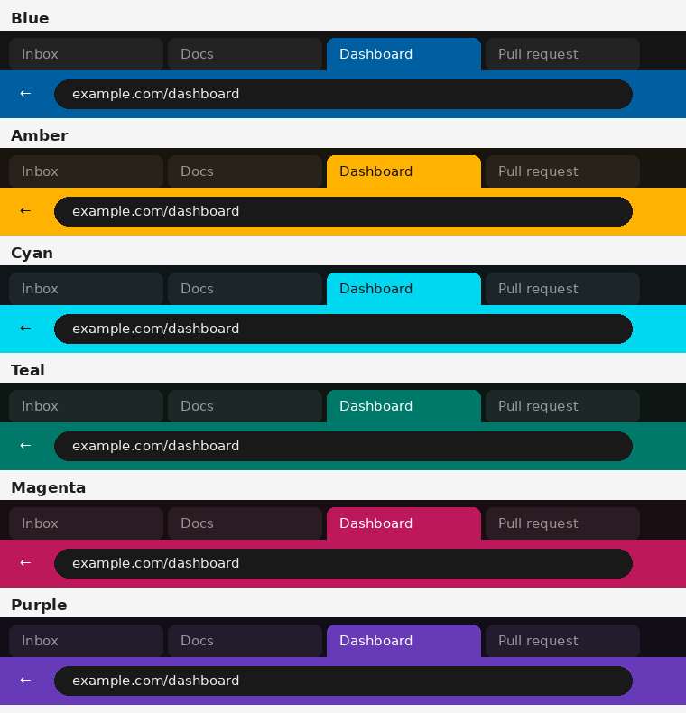

# ActiveTabTheme

Dark Chrome and Edge themes that make the **active tab easy to spot**.

Chrome's default dark mode gives the active tab only a subtle change in shade, so it can be hard to tell which tab you are on. These themes keep the browser dark and give the active tab and toolbar a strong, saturated color, while inactive tabs stay dark with dimmed titles.

There are six color variants. Use a different one in each browser (for example **Blue in Chrome** and **Amber in Edge**) to tell at a glance which browser you're working in.



## Variants

| Variant | Folder | Active tab | Text on active tab | Best for |
|---|---|---|---|---|
| **Blue** | `ActiveTabTheme/` (this folder) | `rgb(0, 95, 160)` | White | Everyday use; calm but clear |
| **Amber** | `variants/Amber/` | `rgb(255, 179, 0)` | Near-black | Bright rooms and direct sunlight |
| **Cyan** | `variants/Cyan/` | `rgb(0, 215, 240)` | Near-black | Bright rooms and direct sunlight |
| **Teal** | `variants/Teal/` | `rgb(0, 121, 107)` | White | Everyday use |
| **Magenta** | `variants/Magenta/` | `rgb(190, 24, 93)` | White | Everyday use; very distinct from blue |
| **Purple** | `variants/Purple/` | `rgb(103, 58, 183)` | White | Everyday use |

Each variant also tints the dark tab strip slightly toward its own color, so the browser stays recognizable even when its window isn't focused.

### Contrast

All text meets WCAG AA contrast (4.5:1 or higher).

| Variant | Text on active tab | Active tab vs. inactive tabs |
|---|---|---|
| Blue | 6.7 : 1 | 2.4 : 1 |
| Amber | 10.4 : 1 | **8.8 : 1** |
| Cyan | 10.7 : 1 | **8.8 : 1** |
| Teal | 5.3 : 1 | 2.9 : 1 |
| Magenta | 6.0 : 1 | 2.7 : 1 |
| Purple | 7.3 : 1 | 2.3 : 1 |

The second column is what makes the active tab stand out. Amber and Cyan are bright tabs with dark text, so they stand out almost four times more than the others. That makes them the most readable in sunlight or on a dim, glossy screen. The other variants rely more on color than brightness.

### Suggested pairs

| Chrome | Edge | Why |
|---|---|---|
| Blue | Amber | Cool vs. warm, and white vs. dark text. Hardest to confuse. |
| Cyan | Magenta | Both very vivid, opposite hues. |
| Teal | Purple | Softer pair for low-light work. |

Avoid Blue in Edge if you want to tell the browsers apart, since Edge's own branding is blue.

## Installation

### Chrome

1. Clone the repository:
   ```bash
   git clone https://github.com/darioernesto-roca/chrome-extensions.git
   ```
2. Open `chrome://extensions` and turn on **Developer mode** (top-right corner).
3. Click **Load unpacked** and select the folder of the variant you want: `ActiveTabTheme` for Blue, or a folder inside `ActiveTabTheme/variants/` for the others.

### Microsoft Edge

1. Open `edge://extensions` and turn on **Developer mode** (bottom-left of the sidebar).
2. Click **Load unpacked** and select a variant folder, for example `ActiveTabTheme/variants/Amber`.
3. If the colors don't change right away, go to `edge://settings/appearance` and select the theme.

A browser uses one theme at a time. Loading a second theme replaces the first, so load only one variant per browser (or per browser profile).

## Customizing

Each variant is a single `manifest.json`. The keys that matter most:

| Key | What it colors |
|---|---|
| `toolbar` | The active tab and the toolbar below the tabs |
| `tab_text`, `toolbar_text`, `toolbar_button_icon` | Text and icons on the active tab and toolbar. Use white on dark colors and near-black on bright ones. |
| `background_tab` | Inactive tabs |
| `tab_background_text` | Inactive tab titles. Keeping these dimmed helps the active tab stand out. |
| `frame` | The tab strip behind the tabs |

After editing, click the reload icon on the theme in `chrome://extensions` or `edge://extensions`.

## Removing the theme

- **Chrome:** Settings → Appearance → **Reset to default**.
- **Edge:** remove the theme in `edge://extensions`, or choose another theme in `edge://settings/appearance`.

## Notes

- Themes don't apply to Incognito (Chrome) or InPrivate (Edge) windows; those always use the browser's own dark look.
- The themes contain only color values: no code, no permissions, and no data collection.

## License

MIT
